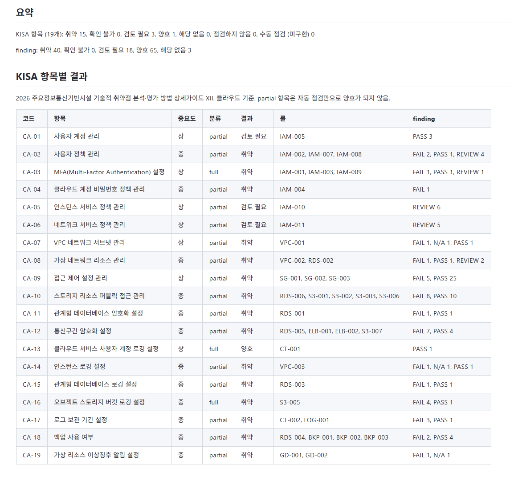
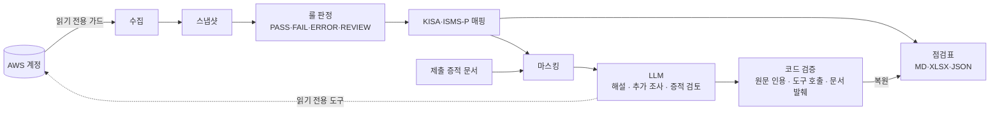
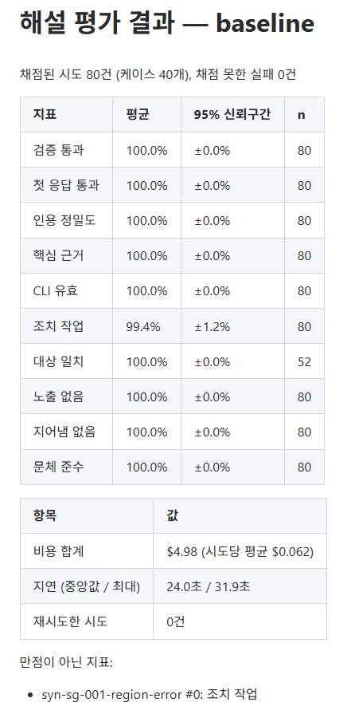
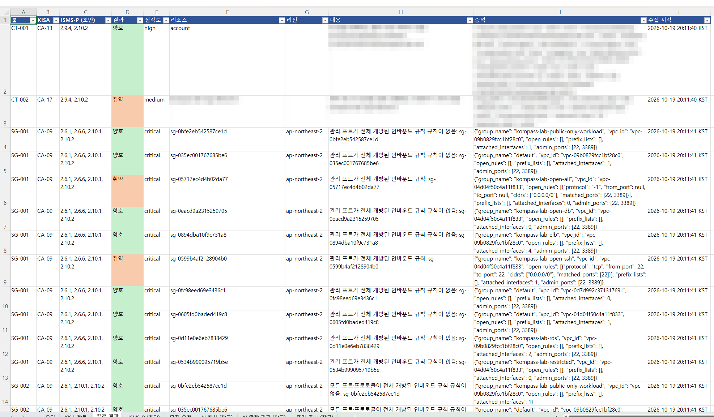
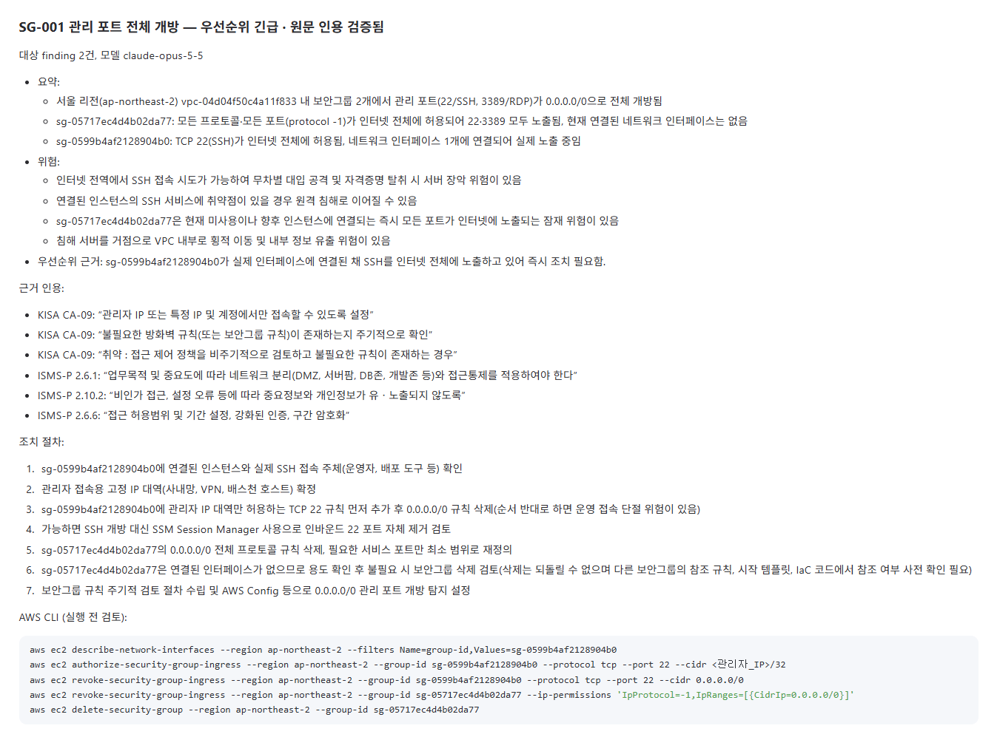
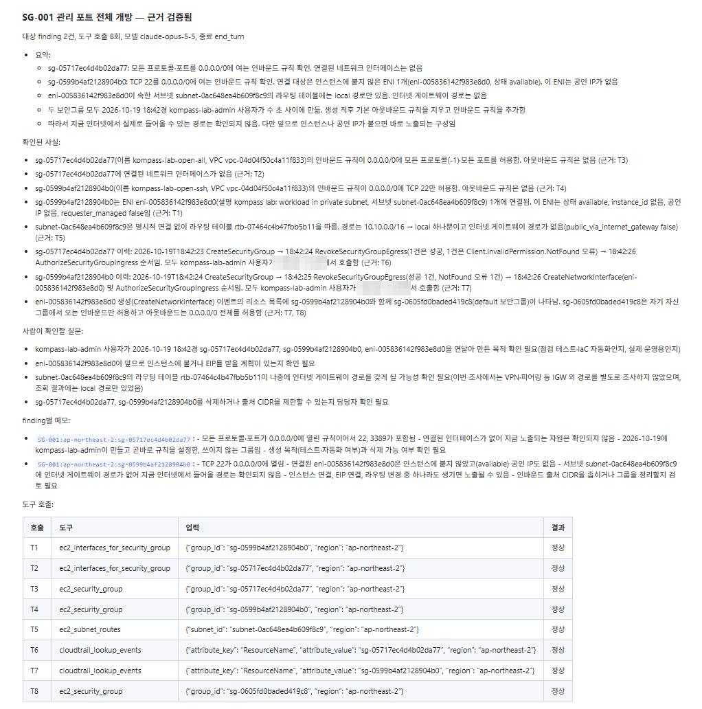

# kompass-isms

AWS 계정을 읽기 전용으로 점검해 KISA 클라우드 취약점 점검 가이드·ISMS-P 기준의 점검표를 만들고, LLM이 원문 근거 해설과 증적 문서 검토를, 에이전트가 읽기 전용 추가 조사를 맡는 보안 진단 도구.
판정은 결정론적 룰이 내리고, LLM 출력은 원문·도구 호출 기록·문서 발췌와 코드로 대조해 검증하며, 품질은 평가셋으로 수치화함.

*실습 계정 점검 보고서의 KISA 클라우드 19개 항목 결과*

## 핵심 수치

| 항목 | 값 |
|---|---|
| LLM 해설 평가 | 77개 케이스, 실제 모델 154회 시도(약 $10). 기준선 40개 × 2회에서 인용 검증 통과 100%, 조치 작업 일치 99.4% |
| 증적 문서 검토 평가 | 8개 케이스(프롬프트 주입·개인정보 포함). 9개 지표 모두 100%, 8개 1회 실행 약 $0.34 |
| 에이전트 추가 조사 | 실습 계정 32개 룰의 조사 결과 근거 검증 32/32, 읽기 전용 도구 호출 190회, 약 $5.77 |
| 점검 범위 | AWS 9개 서비스 41개 룰 |
| 검증 | 테스트 1,181개, 실습 AWS 계정 기대값 121건(선택 리소스 조합별) 대조 |
| 개발 | 2026.10 (약 2주), 커밋 130여 개, 설계 결정 기록(ADR) 54건 |

| 기준 | 전체 | 자동 점검 | 양호까지 자동 판정 | 사람 확인 병행 |
|---|---|---|---|---|
| KISA 클라우드 점검 항목 | 19 | 19 (100%) | 3 (16%) | 16 (84%) |
| ISMS-P 통제항목 | 101 | 15 (15%) | 0 | 15 (기술 증적만 제공) |

## 문제와 접근

- **문제**: 클라우드 ISMS-P·KISA 점검은 설정 수집 뒤에도 점검표 작성, 기준 원문 인용, 조치안 작성, 담당자 증적 요청·검토가 대부분 수작업임.
- **LLM만으로 판정할 때의 한계**: 같은 입력에도 결과가 달라지고, 기준 조항이나 리소스를 지어낼 수 있으며, 판정 근거를 감사인에게 설명하기 어려움.
- **접근**: 판정은 재현 가능한 코드가, 판정 이후의 해석·조사·문서 검토는 LLM이 맡음. LLM의 모든 주장에는 코드로 대조할 수 있는 근거를 요구함.

## 아키텍처

- **결정론 계층**: 수집과 판정을 분리해 스냅샷만으로 재판정·재현 가능함. 판정 결과는 이후 변경되지 않음.
- **LLM 계층**: 확정된 판정 결과를 마스킹해 읽기만 하며, 출력은 검증 결과와 함께 보고서의 "참고" 절에 붙음(검증 실패는 "검증되지 않음"으로 표시).

## LLM 활용 지점

| 기능 (명령) | LLM이 하는 일 | 목적 | 출력 검증 |
|---|---|---|---|
| 룰별 해설 (`explain`) | 원문 인용, 위험 설명, 우선순위, 조치 방안(AWS CLI·Terraform) 작성 | 근거 인용·조치안 작성 시간 단축 | 인용 코드·구절을 원문과 대조 |
| 종합 위험 평가 (`explain`) | 여러 결과가 겹쳐 생기는 위험 시나리오와 조치 순서 작성 | 복합 위험과 조치 우선순위 파악 | 시나리오의 finding·조치 순서를 실제 결과와 대조 |
| 에이전트 추가 조사 (`investigate`) | 읽기 전용 도구로 정책·변경 이력·권한 시뮬레이션 등을 스스로 추가 조회 | 콘솔 확인 작업을 대신해 판단 근거 보강 | 사실마다 근거 도구 호출 ID를 호출 기록과 대조 |
| 증적 문서 검토 (`review-evidence`) | 제출 문서에서 확인된 사실·부족한 점·추가 요청 정리 | 자동 점검이 불가능한 항목의 검토 시간 단축 | 사실마다 문서 발췌가 실제 문서에 있는지 대조 |
| MCP 서버 (`mcp`) | Claude Code 등 외부 LLM 클라이언트가 판정 결과·조사 도구 호출 | 대화형 결과 탐색·조사 | 같은 마스킹·읽기 전용 가드·호출 상한 |

설정 수집, 판정, 매핑, 점검표, 증적 요청서에는 LLM을 쓰지 않음. 모든 LLM 단계는 선택 실행이며 판정을 바꾸지 않음.

## AI 설계의 핵심

1. **판정과 해석의 분리**: LLM 응답 스키마에 `status`·`severity` 필드가 없고 판정 결과 모델은 동결(frozen)되어, LLM이 판정을 바꿀 경로가 코드에 없음. 조사 전후 판정 불변을 테스트로 확인함.
2. **식별정보 마스킹**: 계정 ID·ARN·IP·리소스 이름을 종류를 남긴 자리표시자(`MASKED_SG_1`)로 바꿔 보내고 응답을 로컬에서 복원함. 전송 직전에 원본 값이 남아 있으면 보내지 않음(fail closed).
3. **원문 인용 검증**: KISA·ISMS-P 원문을 항목 코드 단위로 색인해 매핑된 코드로 꺼내 넣음. 인용이 원문에 없으면 한 번 다시 요청하고, 그래도 틀리면 "검증되지 않음"으로 표시함. 항목 코드가 이미 정해져 있어 벡터 검색은 쓰지 않음.
4. **에이전트 도구 설계**: 범용 API 호출 대신 응답 형태가 정해진 읽기 전용 도구 12개만 제공해 처음 보는 식별자도 필드 단위로 마스킹함. 호출 수·반복·토큰 예산과 조사 로그를 둠.
5. **신뢰할 수 없는 입력**: 제출 증적 문서 속 지시는 따르지 않도록 하고(평가셋에 프롬프트 주입 케이스 포함), 개인정보는 패턴·이름 사전으로 가린 뒤 전송 전 미리보기로 사람이 확인함.

## LLM 품질 평가

LLM 판정자 없이 코드 채점기로만 평가해, 같은 응답은 언제 채점해도 결과가 같고 기록한 응답으로 비용 없이 다시 채점할 수 있음.

- **평가셋**: 실습 계정 결과를 가짜 식별자로 가공한 케이스에, 실습에서 나오지 않는 상황(권한 오류, 검토 필요, 상태 혼합)을 다루는 보강 케이스를 더함. 증적 검토 케이스는 프롬프트 주입·개인정보를 담은 가공 문서로 작성함.
- **지표**: 인용 검증·정밀도, 핵심 근거 인용, CLI 명령 유효성(botocore 모델 대조), 조치 작업·대상 리소스 일치, 식별정보 노출, 자리표시자 지어냄, 문체.
- **채점기 검증**: 정답을 내는 오라클은 만점, 오답을 내는 널은 0점이 나와야 실제 모델을 돌림. 채점기 오판을 고치면 기존 결과를 다시 채점해 확인함.
- **평가가 찾은 결함**: 자리표시자 번호 10 이상에서 요청을 모두 막던 마스킹 버그, 조치 명령에 필요한 백업 계획 ID가 증적에 없던 문제 등. 증적 검토는 프롬프트를 고쳐 과잉 지적을 6건에서 0건으로 줄임.
- **한계**: 지표가 대부분 만점이라 지금은 회귀 검출용임. 개선 측정에는 더 어려운 케이스나 LLM 판정자 지표가 필요함.

*해설 평가셋 기준선: 40개 케이스 × 2회, 10개 지표와 비용·지연*

## 결과물

실습 계정(취약·양호 리소스를 함께 배포한 별도 AWS 계정)을 점검한 실제 출력임. 계정 ID·버킷 이름 접미사·출발지 IP는 가렸고, 보안그룹 등 실습 리소스 ID는 일회용이라 그대로 둠.

**점검표**: 룰별 판정에 KISA 항목·ISMS-P 통제항목, 대상 리소스, 판정 근거가 된 원본 설정(증적)을 붙임. Markdown·Excel·JSON으로 출력함.

**LLM 해설**: SG-001(관리 포트 전체 개방)에 대한 원문 인용, 위험, 조치 절차, AWS CLI 명령. 인용은 원문 대조를 통과해 "원문 인용 검증됨"으로 표시됨.

**에이전트 추가 조사**: 같은 SG-001에 대해 에이전트가 네트워크 인터페이스·서브넷 라우팅·CloudTrail 이력을 직접 조회함(도구 호출 8회). 해설은 판정 결과만 보고 SSH가 "실제 노출 중"이라고 썼으나, 조사는 연결된 인터페이스에 공인 IP와 인터넷 게이트웨이 경로가 없어 현재 외부 접근 경로가 확인되지 않음을 밝힘. 판정(취약)은 그대로 두고 사실마다 근거 호출(T1~T8)을 달아 사람이 판단할 근거만 보강함.

## 기술적 도전

**1. 마스킹 누락으로 식별자가 LLM에 전송된 사고**
첫 두 차례의 실제 해설 실행 뒤 프롬프트를 로컬에서 재구성해 검사하다 실습 계정의 S3 버킷 이름 4개와 서브넷 ID 1개가 가려지지 않고 전송된 것을 발견함. 원인은 이름 수집 범위 누락, dict 키 미마스킹, 치환 순서 문제였고, 테스트 데이터가 실제 증적 형태와 달라 드러나지 않았음. 전송 직전 검사(fail closed)와 실제 증적 형태의 회귀 테스트, 평가 지표 "식별정보 노출 없음"을 더함. 같은 실습 결과의 재검사와 이후 모든 평가 실행에서 노출 0건.

**2. 마스킹과 출력 품질의 상충**
기본 파라미터 그룹 이름(`default.mysql8.0`)까지 가려지자 모델이 수정할 수 없는 기본 그룹을 고치는 명령을 냈고(대상 일치 91.7%), 조사에서는 `root`가 가려져 불필요한 확인 질문이 생김. AWS가 정한 고정 값(`root`, ELB ARN의 종류 구간)만 마스킹에서 제외하고, 경계는 평가 지표로 확인하며 조정함. 기본 파라미터 그룹 이름의 제외 여부는 남은 과제로 둠.

**3. 확인하지 못한 대상이 "대상 없음"으로 보고된 결함**
AWS 자격증명 보고서가 4시간 안의 보고서를 재사용해, 실습 재배포 직후 만든 MFA 미설정 사용자가 빠지고 룰이 "해당 사용자 없음"으로 보고함. 보고서에 없는 사용자마다 ERROR를 내고 생성 시각을 증적으로 남겨, 데이터가 없다는 것을 양호로 보고하지 않도록 고침.

## 클라우드 보안 관점

- **읽기 전용 이중 보장**: 점검 자격증명에는 `SecurityAudit`만 부여하고, 코드에서도 botocore 호출 직전 훅으로 조회 API(`Describe*`·`Get*`·`List*`, 자격증명 보고서 생성) 외 호출을 차단함. 예외 3개는 작업 이름 단위로만 허용하고 ADR로 기록함.
- **확인하지 못한 것은 양호가 아님**: 권한 오류·수집 실패는 `ERROR`, 사람의 판단이 필요한 경우는 `REVIEW`로 구분함.
- **근거 있는 매핑**: KISA·ISMS-P 매핑은 원문 구절과 대조한 뒤에만 확정하고 근거 수준(직접·해석)을 기록함.
- **실습 환경**: 별도 AWS 계정에 Terraform으로 취약·양호 리소스를 배포하고, 기대 결과표와 실제 판정을 대조하는 통합 테스트를 둠.

## 개발 방식

- 수집·판정 → 매핑·보고서 → LLM 해석 → 에이전트화 → 확장 순의 단계별 계획으로 진행하고, 설계 결정은 ADR로 남김.
- 룰마다 양호·취약·권한 오류 테스트를 먼저 작성하고, 단위마다 ruff·mypy strict·pytest를 통과시킨 뒤 다음 단위로 넘어감.
- 구현은 Claude Code와 함께 진행함. 기준 원문 대조와 매핑 확정, 실습 환경 배포, 평가 케이스·채점 결과 승인, 읽기 전용 허용 목록 변경은 직접 판단함.

## 한계와 다음 단계

- **평가**: 어려운 케이스(다중 리전 권한 오류, 정책 해석이 필요한 IAM)와 LLM 판정자 지표 보강 필요. 종합 위험 평가는 아직 평가셋이 없음.
- **LLM**: 로컬 LLM 공급자는 인터페이스 자리만 있음. 폐쇄망·데이터 반출 제한 환경에서 쓰려면 구현 필요.
- **범위**: ISMS-P 매핑은 인증 담당자 검토 전 초안임. Azure와 다른 기준(CSAP 등)은 미지원.

## 링크

- 저장소: <https://github.com/zelopy/kompass-isms>
- 사용법: [README.md](../README.md)
- 설계: [ARCHITECTURE.md](ARCHITECTURE.md), 결정 기록 [DECISIONS.md](DECISIONS.md), 룰 목록 [RULES.md](RULES.md)
- 평가셋: [evals/README.md](../evals/README.md)
